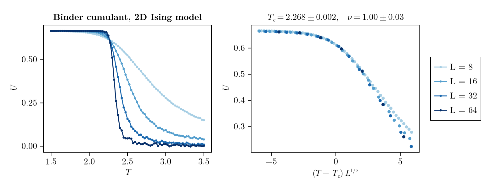

# ScalingCollapse.jl

[](https://maltepuetz.github.io/ScalingCollapse.jl/stable/)
[](https://maltepuetz.github.io/ScalingCollapse.jl/dev/)
[](https://github.com/maltepuetz/ScalingCollapse.jl/actions/workflows/CI.yml?query=branch%3Amain)
[](https://codecov.io/gh/maltepuetz/ScalingCollapse.jl)
[](https://github.com/JuliaTesting/Aqua.jl)
[](https://doi.org/10.5281/zenodo.10712427)

**Automatic finite-size scaling in Julia.** Given an observable measured for several system
sizes `L`, ScalingCollapse.jl finds the critical point and the critical exponents for which
the curves of all sizes collapse onto a single master curve, and estimates their errors.

<picture>
  <source media="(prefers-color-scheme: dark)" srcset="docs/src/assets/readme-collapse-dark.png">
  
</picture>

## Installation

```julia
using Pkg
Pkg.add("ScalingCollapse")
```

ScalingCollapse.jl requires Julia 1.9 or later.

## Quick start

The Binder cumulant `U` of the 2D Ising model follows `U(T, L) = F((T - T_c) L^(1/ν))` near
the critical temperature. With the temperatures `Ts`, a matrix `binder` with one column per
system size, and the sizes `Ls`:

```julia
using ScalingCollapse

sp = ScalingProblem(Ts, binder, Ls;
    sf=ScalingFunction(:x; p_names=["T_c", "nu"]),  # rescale x as (T - T_c) * L^(1/nu)
    p_space=[2.0:0.02:2.6, 0.5:0.05:1.5],           # where to search
    dx=[-2.0, 2.0],                                 # compare the curves near T_c only
)

sp.optimal_ps        # [2.2683, 0.998]
sp.optimal_ps_error  # [0.0018, 0.035]

xs, ys, es, Ls = scaled_data(sp)  # the collapsed data, e.g. for a plot
```

The fit agrees with the exact values `T_c = 2.2692` and `ν = 1`. The data of this example
ship with the repository, in `test/testdata/IsingMonteCarlo.h5`; the
[2D Ising example](https://maltepuetz.github.io/ScalingCollapse.jl/dev/examples/ising) of
the documentation runs it from start to end.

## Features

- **One call, full fit.** The constructor scans the parameter space, refines the best
  candidates with Nelder–Mead, and estimates the errors.
- **Scaling forms.** Presets for dimensionless observables (`:x`), order parameters (`:xy`)
  and susceptibilities (`:xny`); fix any parameter by name, or write your own scaling
  function.
- **Flexible input.** Common or separate x values per size, matrices, error bars, and
  `Measurement`s from Measurements.jl.
- **Errors.** Profile errors that account for correlated parameters (default), conditional
  errors, or bootstrap errors from the error bars of the data.
- **Diagnostics.** Evaluate the quality of the collapse on a parameter grid to inspect the
  landscape around a fit.

## Documentation

The [documentation](https://maltepuetz.github.io/ScalingCollapse.jl/dev/) contains a
[tutorial](https://maltepuetz.github.io/ScalingCollapse.jl/dev/getting-started), a manual
on [input data](https://maltepuetz.github.io/ScalingCollapse.jl/dev/manual/data),
[scaling functions](https://maltepuetz.github.io/ScalingCollapse.jl/dev/manual/scaling-functions),
[fitting](https://maltepuetz.github.io/ScalingCollapse.jl/dev/manual/fitting) and
[error analysis](https://maltepuetz.github.io/ScalingCollapse.jl/dev/manual/errors), worked
examples with plots, and the API reference.

## Status and contributing

ScalingCollapse.jl is still young: expect breaking changes between minor versions. Bug
reports, questions and suggestions are welcome as
[issues](https://github.com/maltepuetz/ScalingCollapse.jl/issues).

## Citing

If you use ScalingCollapse.jl in your research, please cite it via its Zenodo record,
[doi:10.5281/zenodo.10712427](https://doi.org/10.5281/zenodo.10712427).
